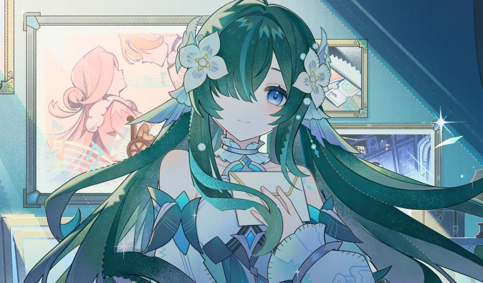

# 聆听我声 · 沃雅妮莎

《原神》沃雅妮莎主题互动动态壁纸，提供 **亮版** 与 **暗色版**，当前发布版本为 **v3.5.5**（暗色渲染修订 Dark.2）。

发丝随风轻动，伴随自然眨眼与微笑。轻触信件与画框，赴一场约定，聆听歌声与来信。两个版本都包含台词互动、旅行者回答、BGM、羽笔光标和可调设置；作者声明可在设置中关闭。

| 版本 | 壁纸名称 | 在线体验 | Wallpaper Engine ZIP | 离线单文件 HTML |
| --- | --- | --- | --- | --- |
| 亮版 | 聆听我声 · 沃雅妮莎 · 亮 | [打开](https://juglanshutao-sudo.github.io/vodyanitsa-listen-wallpaper/Vodyanitsa_Listen/index.html) | [下载亮版 ZIP](https://github.com/juglanshutao-sudo/vodyanitsa-listen-wallpaper/releases/download/v3.5.5/Vodyanitsa_WallpaperEngine_v3.5.5_Bright.zip) | [下载亮版 HTML](https://github.com/juglanshutao-sudo/vodyanitsa-listen-wallpaper/releases/download/v3.5.5/Vodyanitsa_Interactive_v3.5.5_Bright.html) |
| 暗色版 | 聆听我声 · 沃雅妮莎 | [打开](https://juglanshutao-sudo.github.io/vodyanitsa-listen-wallpaper/Vodyanitsa_Listen_Dark/index.html) | [下载暗色版 ZIP](https://github.com/juglanshutao-sudo/vodyanitsa-listen-wallpaper/releases/download/v3.5.5/Vodyanitsa_WallpaperEngine_v3.5.5_Dark.zip) | [下载暗色版 HTML](https://github.com/juglanshutao-sudo/vodyanitsa-listen-wallpaper/releases/download/v3.5.5/Vodyanitsa_Interactive_v3.5.5_Dark.html) |

暗色版对主页面角色亮部及两种听歌页面降低亮度，保留动画、背景素材与交互。

| 亮版 | 暗色版 |
| --- | --- |
|  |  |

## 使用

- **Wallpaper Engine**：下载对应 ZIP，完整解压，将其中的项目文件夹复制到 Wallpaper Engine 安装目录的 `projects/myprojects/` 下，再在编辑器已有项目中选择它。不要把 `project.json` 当作图片或模型素材导入。
- **浏览器离线体验**：下载对应 HTML 文件，直接用浏览器打开；图片、音频及脚本均已内嵌，首次播放声音可能需要点击页面。
- **在线体验**：使用上表链接。在线版按需加载项目素材；离线使用请下载单文件 HTML。
- 作者的亮版创意工坊作品：[3818400499](https://steamcommunity.com/sharedfiles/filedetails/?id=3818400499)。

上传或更新说明见 [导入与发布说明](先读我-WallpaperEngine导入与发布.txt)。下载包不携带作者的创意工坊 ID。

## 源码与构建

- `Vodyanitsa_Listen/`：亮版完整工程。
- `Vodyanitsa_Listen_Dark/`：暗色版完整工程。
- `skills/`：已有的互动壁纸制作技能和参考文档。
- `scripts/build_release.py`：从这两份源码生成两个 ZIP、两个独立 HTML 和 SHA-256 校验文件。

使用 Python 3.10 或更新版本运行 `python scripts/build_release.py`，产物写入 `.release/`。正式下载文件在 [Releases](https://github.com/juglanshutao-sudo/vodyanitsa-listen-wallpaper/releases/tag/v3.5.5) 中提供，不重复存入源码目录。

## 来源与许可证

原图及角色来源：《原神》沃雅妮莎逸闻。动态与交互制作：ZZZ传奇绳匠法厄同。

本项目为非商业粉丝作品，代码部分沿用 [MIT License](LICENSE)。《原神》角色、图像、音乐和语音等素材的权利归原权利人所有，不包含在本项目代码的 MIT 授权范围内。
